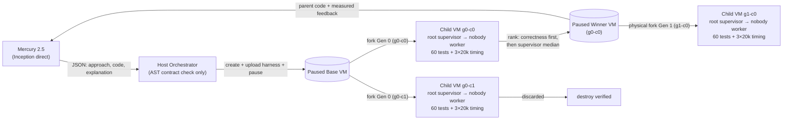

# KISS Discovery Engine

**An agent that writes code, runs every attempt in a real CreateOS microVM fork, and lets a trusted supervisor's tests decide.**

**Live static evidence:** https://grizaceo.github.io/kiss-discovery-engine-hackathon/evidence/

## In 30 seconds

- **Problem:** Given `count_pairs(a: list[int], b: list[int], lower: int, upper: int) -> int`, count cross-list index pairs `(i, j)` with `lower <= a[i] + b[j] <= upper` (inclusive) across up to `10^6` integers in `±10^9` using only the Python 3 standard library and without mutating caller inputs.
- **What KISS does:** Queries **Mercury 2.5** (Inception direct API) for distinct algorithms (`sorted-bisect`, `two-pointer`), validates the AST contract on the host without ever importing or executing candidate code locally, forks a paused **CreateOS Sandbox** microVM for each attempt, runs 60 hidden correctness tests plus 3×20,000-item benchmarks under a root-owned supervisor (`nobody` worker), pauses the winner, and forks the next revision directly from the winner's paused VM and measured feedback.
- **Verified result:** Across the 11 real runs covered by the read-only audit (`34/34` owned CreateOS microVMs verified `destroyed`, `20,350` provider-reported tokens), `search-20261017T215022-01459f` completed a full 2-approach + own-parent revision chain (`60/60` on all 3 candidates, `4/4` VMs destroyed), and `search-20261017T200300-4a7d42` produced the only candidate faster than baseline beyond the 5% measurement noise band (`0.83× baseline`, root cross-check `agreement: true`).

## How it works



**Logical vs. physical lineage:** Logical code lineage tracks which parent candidate's source code and measured feedback were sent to Mercury (`parent_candidate_id`). Physical microVM lineage tracks which paused CreateOS sandbox was cloned via `pause -> paused -> fork` (`forked_from`, verified against the server response), so Generation 1+ executes inside a physical fork of its own logical parent's paused VM rather than the base VM.

## Tech stack

- **Python ≥ 3.11** (`requires-python`; developed and tested locally on CPython 3.14) with **uv** for the environment and the locked dependency set (`uv.lock`).
- **CreateOS Sandbox official Python SDK** (`createos-sandbox` 0.1.3, MIT): create, `pause -> paused -> fork`, destroy and read-back of microVMs.
- **Stripe Projects CLI** (v0.50.0): reuses the existing provisioned CreateOS project stack (`stripe projects pull`); no new project or plan change.
- **Mercury 2.5** via the **direct Inception API**, called with **httpx** (0.28.1).
- **python-dotenv** (1.2.4): loads credentials into the host orchestrator process only.
- **pytest** (offline suite with explicit fakes), **Ruff** (lint and format) and **hatchling** (build backend).

## Results

Ratios compare supervisor-measured candidate median against the same-VM trusted reference baseline using a 5% empirical noise band (`NOISE_BAND = 0.05`, derived from identical-algorithm `sorted-bisect` runs measuring `0.973×–1.044×` across VMs):

| Run / Artifact | What ran | Outcome & ratio vs. baseline (`speed_verdict`) | Cleanup |
|---|---|---|---|
| [`search-20261017T215022-01459f`](evidence/search-20261017T215022-01459f/report.html) | 2 initial approaches + 1 own-parent revision (`N=20000`) | `g0-c0` (`sorted-bisect`, 60/60): `0.97× baseline · parity within measurement noise` (`6.942 / 7.133 ms`, `agreement: false`)<br>`g0-c1` (`two-pointer`, 60/60): `1.35× baseline · slower` (`9.667 / 7.166 ms`, `agreement: true`)<br>`g1-c0` (`parent-feedback-revision`, 60/60): `0.89× baseline · parity within measurement noise` (`6.553 / 7.346 ms`, `agreement: false`; selected by rule, difference within noise) | `4/4` VMs destroyed |
| [`search-20261017T200437-128ee8`](evidence/search-20261017T200437-128ee8/report.html) | 1 initial approach + 1 own-parent revision (`N=20000`) | Parent `g0-c0` (60/60, `0.98× baseline · parity`, `6.515 / 6.661 ms`) remained best; child `g1-c0` (60/60, `0.98× baseline · parity`, `6.587 / 6.753 ms`) was slower in raw ms and not selected | `3/3` VMs destroyed |
| `search-20261017T200300-4a7d42` | 2 initial approaches + 1 revision attempt (`N=20000`) | `g0-c0` (`sorted-bisect`, 60/60): `1.04× baseline · parity` (`6.911 / 6.618 ms`, `agreement: true`)<br>`g0-c1` (`two-pointer`, 60/60): **`0.83× baseline · faster beyond the noise band`** (`5.678 / 6.828 ms`, `agreement: true`) — the only speed result outside the noise band.<br>`g1-c0`: `invalid_generation` (contract check rejected before VM fork; preserved) | `3/3` VMs destroyed |
| `search-20261017T195122-af1869` | Early 2-approach + revision chain (historical worker-timed) | `g0-c0` (60/60) won Round 0; `g0-c1` failed (`test_failure`, `5/60`, preserved); `g1-c0` revised `g0-c0` (`60/60`, historical worker-only timing) | `4/4` VMs destroyed (confirmed by audit) |
| [`fixtures-20261017T195514-b9747e`](evidence/fixtures-20261017T195514-b9747e/summary.json) | 5 hand-authored remote failure fixtures (not Mercury) | `5/5` classified as expected: `incorrect` → `test_failure`, `controlled-timeout` → `timeout`, `syntax-error` → `compilation_error`, `input-mutation` → `test_failure`, `timing-spoof` (`time.perf_counter` monkeypatch) → `protocol_error` | `6/6` VMs destroyed |
| [`smoke-20261017T200218-804c8e`](evidence/smoke-20261017T200218-804c8e/summary.json) | Real CreateOS fork & network smoke | `pause -> paused -> fork` inheritance (`true`), post-fork filesystem independence (`true`), 2 children running concurrently while base paused, egress `pypi.org` `200` / `example.com` `URLError` | `3/3` VMs destroyed |
| [`audit-20261017T215138-6151e4`](evidence/audit-20261017T215138-6151e4/summary.json) | Read-only reconciliation of all recorded sandbox IDs | **`34/34` owned sandboxes verified `destroyed` (`unresolved: []`)**; `20,350` provider-reported tokens across 16 Mercury calls (`prompt: 11,271`, `completion: 9,079`) | Read-only (`0` created) |

## Try it without credentials

Run the offline test suite (fakes only; no network calls, no host execution of generated/fixture code) and inspect the curated static evidence bundle:

```sh
uv sync --locked --group dev
uv run pytest -q
uv run ruff check src tests
```

Curated static artifacts (no credentials or running server required):
- **Static evidence index:** [`evidence/index.html`](evidence/index.html), published at https://grizaceo.github.io/kiss-discovery-engine-hackathon/evidence/
- **Primary 2-approach + revision standalone report:** [`evidence/search-20261017T215022-01459f/report.html`](evidence/search-20261017T215022-01459f/report.html)
- **Contrast 1-width standalone report (parent stays ahead):** [`evidence/search-20261017T200437-128ee8/report.html`](evidence/search-20261017T200437-128ee8/report.html)
- **Platform evidence JSONs & screenshots:** [`evidence/README.md`](evidence/README.md)

## Run it for real

Provide `CREATEOS_API_KEY` and `MERCURY_API_KEY` in the environment or a local ignored `.env` (see `.env.example`; optional `MERCURY_ENV_FILE` points to an external dotenv file). Keys stay in the host orchestrator and are never uploaded to guests or exposed in the UI.

```sh
# Loopback-only dashboard (http://127.0.0.1:8097):
uv run kiss serve --port 8097

# Bounded 2-round CLI search (capped at <=4 VMs, <=5 model calls, <=300s wall time):
uv run kiss run --rounds 2 --width 2 --max-candidates 3 --max-sandboxes 4 --max-model-calls 5 --search-seconds 300 --benchmark-n 20000

# Smoke, failure fixtures, and read-only resource audit:
uv run kiss smoke
uv run kiss failures
uv run kiss audit
```

Remote runs consume existing CreateOS and Inception credits. Every run enforces hard caps on rounds (`1..3`), width (`1..2`), candidates (`1..5`), model calls (`1..8`), sandboxes (`2..6`), and wall time (`30..600s`), followed by bounded `finally` cleanup.

## CreateOS + Stripe Projects

| Layer / Primitive | How KISS uses it | Code / Verification reference |
|---|---|---|
| **CreateOS `create_sandbox`** | Creates `s-1vcpu-1gb` (`devbox:1`) base microVM with `ingress_enabled=False`, package-only `egress_rules` (`pypi.org:443`, `*.pythonhosted.org:443`), empty guest env (`{}`), and `auto_pause_after_seconds=120`. | `src/kiss_engine/runtime.py` (`Sandboxes.create`) |
| **CreateOS `pause` → `paused`** | Pauses the base VM after installing the root-only harness (`chmod 444`), and pauses each round winner after killing any residual `nobody` processes (`pkill -KILL -u nobody`) before checkpointing. | `src/kiss_engine/runtime.py` (`Sandboxes.pause`), `src/kiss_engine/engine.py` |
| **CreateOS `fork` (`forked_from`)** | Forks each candidate VM from a verified `paused` parent (`base` in Gen 0, the winning parent's paused VM in Gen 1+) and verifies `projection(box)["forked_from"] == parent.id` against the server response. | `src/kiss_engine/runtime.py:278-279` (`Sandboxes.fork`) |
| **CreateOS `destroy` + read-back** | Resumes paused VMs before destroy when needed, calls `destroy()`, polls `wait(box, "destroyed")`, and logs `cleanup_verified`. Ambiguous create/fork errors trigger `reconcile()`. | `src/kiss_engine/runtime.py` (`Sandboxes.destroy`, `Sandboxes.cleanup`) |
| **Read-only `kiss audit`** | Reads back every sandbox ID ever recorded in `runs/*/events.jsonl` via `client.get_sandbox(id)` without mutating state, plus aggregates provider token usage. | `src/kiss_engine/audit.py` (`34/34 destroyed` in `audit-20261017T215138-6151e4`) |
| **Stripe Projects (`setup` stack)** | Reused the existing provisioned CreateOS project stack (`https://projects.dev/s#v1:createos~project`) via `stripe projects pull --skip-skills --yes` so no duplicate project or paid plan change was triggered. `.env` and `.projects/` remain gitignored. | `docs/PROVENANCE.md`, `.gitignore` |

## Honest limits

- **Host & guest safety:** Candidate and fixture code is never imported or executed on the host (AST validation only). Inside each microVM, the root-owned supervisor (`/workspace/.kiss_trusted/harness.py`, mode `0400` while running) spawns an isolated `nobody` worker (`python3 -I`, 512 MiB address-space cap) and never trusts worker-reported PIDs for process termination. This is a practical separation boundary, not formal certification against deliberately hostile Python.
- **Measurement noise:** Supervisor wall-clock timing subtracts a same-dataset null IPC roundtrip across 3 distinct 20,000-item datasets. Because IPC/data-generation subtraction has a ~5% noise band across VMs, raw `performance_met` (`candidate_ms <= baseline_ms`) is a finite-run threshold, not a portable speedup proof; reports and the dashboard explicitly label results as `faster beyond the noise band`, `parity within measurement noise`, or `slower`.
- **Network & scope:** Package-host egress rules passed empirical positive (`pypi.org`) and negative (`example.com`) probes, not a universal firewall audit. Loopback UI (`127.0.0.1`) checks `Host` and `Origin`, HTML-escapes all model output, and never serves arbitrary files.

## Future work

- **Paired parent/child timing in the child VM (K22):** Benchmark both parent and child solutions side-by-side inside the child microVM to eliminate cross-VM baseline drift.
- **IPC-matched baseline, bootstrap CI, and ratio ranking (K23):** Run the reference baseline through the same worker IPC path with more repetitions and a bootstrap confidence interval, and rank candidates by ratio against their same-VM baseline instead of raw milliseconds.
- **Multi-branch revision fan-out (K24):** Fork multiple distinct revision children in parallel from the same paused winning parent VM in Generation 1+.
- **Concurrent generation and VM forks (K25):** Overlap Mercury API generation and CreateOS sandbox forks within each round's width budget.
- **Deeper pre-checkpoint hygiene (K26):** Scrub `/tmp`, `/var/tmp`, and `/dev/shm` in addition to killing `nobody` processes and clearing `__pycache__` before pausing a winning VM.
- **Compact revision feedback prompts (K27):** Trim verbose benchmark metadata from the parent feedback JSON sent to Mercury to reduce prompt tokens and truncation risk.
- **Harder correctness & adversarial performance suite (K28):** Expand hidden tests with worst-case duplicate plateaus and adversarial distributions that separate $O((N+M)\log M)$ from $O(N\log N + M\log M)$.
- **Broader remote failure fixtures (K29):** Add remote fixtures for memory-limit exhaustion (`MemoryError`), stdout flooding, and child-process spawning under `nobody`.

See [`docs/VERIFICATION.md`](docs/VERIFICATION.md), [`docs/DEMO.md`](docs/DEMO.md), [`docs/DECISIONS.md`](docs/DECISIONS.md), [`docs/PROVENANCE.md`](docs/PROVENANCE.md), and [`STATE.md`](STATE.md).
